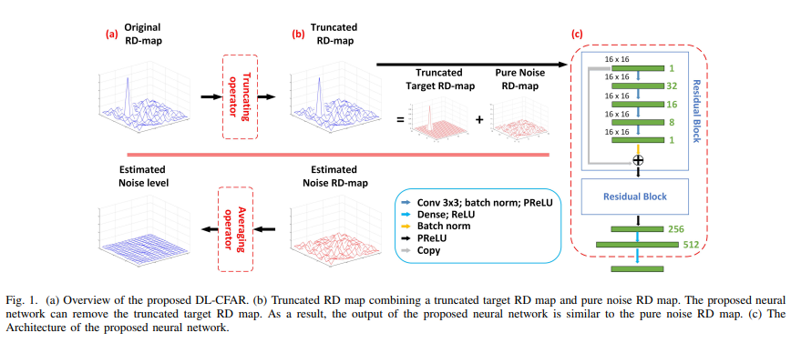
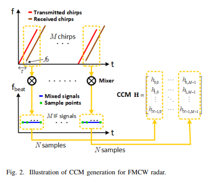
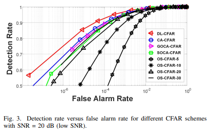
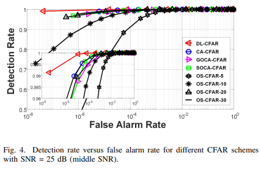
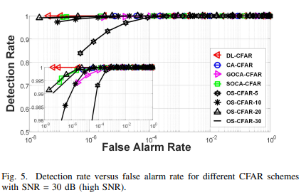
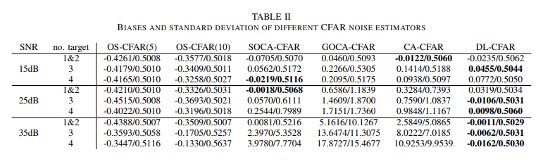
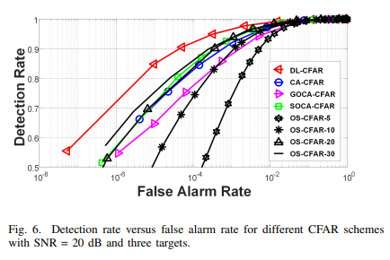
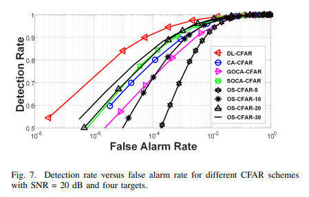

# [Target Detection] A Novel CFAR Target Detection Method Based on Deep Learning: DL-CFAR Coming Along! [With Python + MATLAB Codes]

A New CFAR Target Detection Method Based on Deep Learning: DL-CFAR Coming to the Radar Target Detection Field, constant false alarm rate (CFAR) detection is one of the core technologies. However, traditional CFAR algorithms always face challenges such as masking effects in multi-target scenarios, high computational complexity, and sensitivity to parameters. Today, we will interpret a research paper published in IEEE VTC - DL-CFAR, a new method for CFAR target detection based on deep learning. This method is the first to use deep learning to optimize the noise estimation process of CFAR, achieving performance breakthroughs in multi-target and different signal-to-noise ratio scenarios. It also reduces computational costs, providing a new perspective for radar target detection.
I. Pain Points of Traditional CFAR, which urgently need to be addressed: The core logic of CFAR detection involves evaluating the noise level in the RD graph around the Reference Unit (CUT) through the reference units surrounding the CUT, setting a reasonable threshold to achieve target detection. However, traditional classic algorithms all have significant shortcomings:
1  
CA-CFAR/GOCA-CFAR: Perform well in uniform scenes, but performance drops sharply due to incorrect noise level estimation in multi-target scenarios, with serious occlusion effects.
2  
SOCA-CFAR: Improved for multi-target scenarios, but performance gains are limited in dense multi-target scenarios.
3  
OS-CFAR: It can effectively handle multi-target problems, but it introduces extremely high computational complexity and is difficult to implement.
4  
Common issues: The performance is significantly degraded due to improper parameter settings (such as the size of protection units and the selection of order), and in high signal-to-noise ratio and multi-target scenarios, strong sidelobes from target echoes can lead to an overestimation of noise level, thereby reducing detection rate (i.e., sidelobe problem).
Previous studies have attempted to combine machine learning with CFAR, such as using deep learning to optimize CA-CFAR or support vector machines to select the optimal CFAR algorithm. However, these methods only mimic or select traditional algorithms, resulting in minimal performance improvements. Therefore, developing a robust, low computational complexity, and parameter-free CFAR algorithm for multi-objective scenarios has become a research focus.
The core idea of DL-CFAR is to precisely estimate noise levels using deep learning inspired by image denoising. The research team proposes DL-CFAR, with its innovative point being that neural networks learn the target structure in the RDA (Receiver Detection Array) diagram and remove it, resulting in a pure noise RDA diagram, thereby achieving more precise noise level estimation and fundamentally solving the sidelobe problem and shadowing effect of traditional CFAR.
Unlike traditional methods, DL-CFAR does not rely on regularization operations (such as fixed protection units), but instead adaptively recognizes different scene target patterns through neural networks without requiring manual parameter settings, making it more suitable for practical engineering implementation. The overall framework can be referred to Figure 1(a), with the core process being: inputting the RDA diagram → preprocessing by truncation operation → neural network removing target patterns → outputting the pure noise RDA diagram → precise estimation of noise levels → CFAR detection.
2.1 System Model: Taking FMCW radar as an example, the signal processing of DL-CFAR is based on the channel coefficient matrix (CCM) and the RDA diagram:
1.  
A radar transmits M linear frequency modulated pulses (chirp), mixing the transmitted and received signals to obtain M intermediate frequency (IF) signals, each chirp extracting N sampling points, which are cascaded to form the CCM;
2.  
Perform a two-dimensional fast Fourier transform (2D FFT) on the CCM to obtain the RDA diagram, where each pixel point (RD bin) represents the power sum of the target echo and noise, formulated as follows:
1.  
The 2D FFT provides dB gain in processing, enhancing the target echo power, and subsequent CFAR detection is achieved by identifying peaks in the RDA diagram for target detection.
2.2 Data Preprocessing: Truncation Operations Replaced with Traditional Normalization
The preprocessed truncation RD graph can be considered as the superposition of a truncation target RD graph and a pure noise RD graph (refer to Figure 1(b) in the original text). The core task of neural networks is to separate these two, restoring the pure noise RD graph.
2.3 Neural Network Architecture: Residual Block + Fully Connected Layers, Preserving Complete Spatial Information for DL-CFAR. The neural network architecture for DL-CFAR is designed to fully consider the spatial local correlation of the RD graph and does not include pooling layers, ensuring the preservation of all information in the RD graph for precise noise estimation. The core structure is as follows:
1  
Input: Truncation RD graph with dimensions (experimentally set to 16×16);
2  
Residual Blocks (2): Each residual block consists of a convolutional layer with a 3×3 convolutional kernel (utilizing spatial locality), featuring feature maps in the order of 32, 16, 8, and 1 respectively, with the output size consistent with the input; followed by batch normalization to accelerate convergence and prevent overfitting, then introduced through parameterized relu (PReLU) for nonlinearity.
3  
Fully connected layer (2 layers): The number of neurons is 512 and ReLU activation function, outputting pure noise RD graphs with the same size as the input.
4  
Design Details: Using only 2 residual blocks, increasing the number of residual blocks/layers will not improve performance but will increase computational complexity.
2.4 Training Method: End-to-End Supervised Learning 1
Training data: RD graphs represented as (T is the pure target RD graph, N is the pure noise RD graph), after truncation, it becomes (the truncation target RD graph).
2  
Loss Function: Mean Squared Error (MSE), minimizing the error between the neural network output and the true pure noise RD graph, formula:
(D is the total number of training samples, which represents the network's trainable kernel and bias);
1  
Optimizer and hyperparameters: Use the Adam gradient descent optimizer with an initial learning rate of 0.00005, batch size of 128, and save the weights after training for 500 epochs.
III. Simulation Experiment: DL-CFAR Outperforms Traditional CFAR in a Comprehensive Manner
3.1 Optimal Training Signal-to-Noise Ratio: The SNR at the MRC RD bin is defined as 28dB (median SNR). The research team trained the network with 19 to 39dB of 21 types of SNR, and the validation results are shown in Table I in the original document:
Low Signal-to-Noise Ratio Training: Difficult to learn the target structure in noise environment, performance slightly degraded;
High signal-to-noise ratio training: networks trained in nearly noise-free environments cannot handle actual noise, leading to performance degradation.
28dB median signal-to-noise ratio: The lowest loss is verified, and it is the optimal training signal-to-noise ratio. All subsequent simulations will use this network.
3.2 Noise Estimation Performance: Robustness is maximized, addressing sidelobe issues. Noise estimation is the core of CFAR. The study evaluates it from two indicators: bias and standard deviation, as seen in Table II in the original document. The core conclusion is:
1  
Traditional CA/GOCA/SOCA-CFAR: In high signal-to-noise ratio/multi-target scenarios, sidelobes cause significant increases in bias and standard deviation, leading to severe distortion of noise estimation.
2  
OS-CFAR: Low standard deviation, but there is a problem of underestimating noise level, which easily leads to false alarms.
3  
DL-CFAR: Under different signal-to-noise ratios and target quantities, the bias and standard deviation remain stable, making it the most robust noise estimation method. This is due to the neural network's ability to effectively eliminate target patterns, fundamentally solving sidelobe issues.
3.3 Single-target scenario: Detection rate significantly surpasses traditional CFAR under low false alarm rate, with DL-CFAR achieving superior performance across the entire SNR range (low/medium/high) and particularly shows a significant advantage at extremely low false alarm rates (refer to Figures 3/4/5, corresponding to SNR = 20dB/25dB/30dB).
Low Signal-to-Noise Ratio (20dB): The detection rate of DL-CFAR is much higher than all traditional algorithms.
High/Medium Signal-to-Noise Ratio (25/30dB): All algorithms improve performance, but the detection rate improvement of DL-CFAR is more significant in the false alarm rate and below.
Core reason: The traditional CFAR's fixed-size protection units cannot adapt to various sidelobes, while DL-CFAR can adaptively identify and remove target patterns.
3.4 Multi-target scenarios: The performance degradation under occlusion is minimal, with a significant lead in detection rate compared to multi-target scenarios. As the number of targets increases, its performance significantly degrades, whereas DL-CFAR demonstrates strong robustness (refer to Figure 6/7, SNR=20dB, 3/4 targets):
1  
3. Target scenario: At the false alarm rate (common engineering value), DL-CFAR detection rate is about 6% higher than traditional algorithms.
2  
4. Target scenario: Under the same false alarm rate, the detection rate of DL-CFAR shall be at least increased by 8%.
3  
Commonality: As the number of targets increases, the traditional CFAR detection rate drops sharply, whereas DL-CFAR only slightly decreases. It maintains optimal performance in both single/multiple target scenarios.
3.5 Execution Time: The low computational complexity and the near-CA-CFAR algorithm's engineering implementation are inseparable from computational efficiency. The execution time for different CFAR algorithms is shown in Table III (unit: seconds) in the original text, with the core conclusion:
1  
CA-CFAR: The execution time is the shortest (7.3e-4s), but its performance in multi-target scenarios is extremely poor.
2  
OS-CFAR: The traditional algorithm has the best performance, but it has the highest computational complexity (14.6e-4s).
3  
DL-CFAR (CPU): Execution time 14e-4s, comparable to OS-CFAR, but significantly superior in performance.
4  
DL-CFAR (GPU): The execution time after acceleration is only 8.8e-4s, close to CA-CFAR, and the GPU can further improve the acceleration effect, balancing high performance with low computational complexity.
IV. Conclusion and Prospects
Simulation results demonstrate that DL-CFAR surpasses CA/GOCA/SOCA/OS-CFAR in terms of noise estimation robustness and detection rate under different signal-to-noise ratios and single/multiple target scenarios. It has comparable computational complexity to OS-CFAR, with GPU acceleration approaching the lightest CA-CFAR. Moreover, it eliminates the need for manual parameter settings, offering strong practical engineering application value.
This study opens up new directions in the field of radar target detection. The research team also pointed out that future exploration could further investigate the robustness of DL-CFAR under different environmental clutter, integrating more advanced deep learning techniques with CFAR detection to continuously enhance the performance and applicability of radar target detection.

## Images

<!-- PAYMENT_BLOCK -->

## Get this dataset

- Payment link (Stripe): [Buy now](https://buy.stripe.com/3cs8yP7sY87d0vu9AB)
- Payment QR code: 

<!-- /PAYMENT_BLOCK -->
